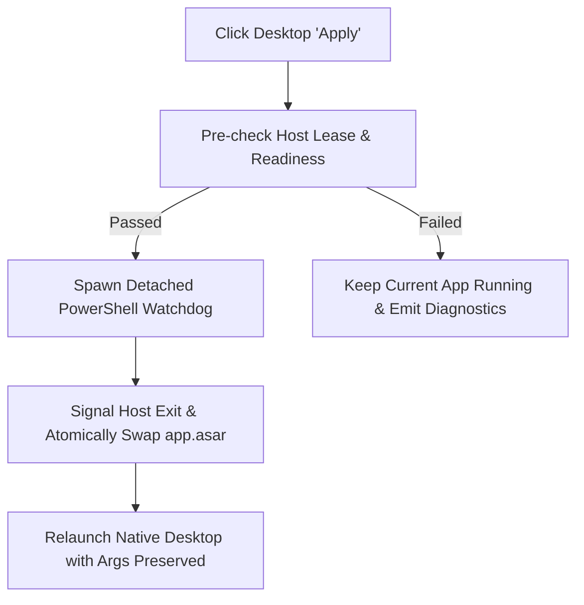

<p align="center">
  
</p>

<h1 align="center">⚔️ DeepSeek Harness Purge Plus (dsh-purge-plus)</h1>

<p align="center">
  <strong>Local Patch Manager · Custom Prompt Engine · Rules & Skills Ecosystem · Integrated Red Team Console for Official DeepSeek Harness</strong>
</p>

<p align="center">
  <a href="https://github.com/ShadowCat2233/dsh-purge-plus/stargazers"></a>
  <a href="https://github.com/ShadowCat2233/dsh-purge-plus/releases"></a>
  <a href="https://www.deepseek.com/harness/"></a>
  <a href="https://nodejs.org/">= 18"></a>
  
  <a href="LICENSE"></a>
</p>

<p align="center">
  <strong>English</strong> · <a href="README.zh-CN.md">简体中文</a>
</p>

---

> [!NOTE]
> **Project Scope & Origins**: This repository is an enhanced maintenance fork of [YuJunZhiXue/dsh-purge](https://github.com/YuJunZhiXue/dsh-purge) (originally created by **小杨**), maintained by [@ShadowCat2233](https://github.com/ShadowCat2233) on top of [@JeffKeeping](https://github.com/JeffKeeping)'s branch.
> 
> This fork focuses on **guaranteeing out-of-the-box reliability for official DeepSeek Harness 0.2.1-rc.2 and 0.2.x**. It completely resolves the notorious Windows desktop restart hang/crash on patch apply, fixes system prompt variable resolution errors, and preserves the complete local red team cybersecurity workbench with 23 bundled security skills.

---

## Table of Contents

- [🌟 Why dsh-purge-plus?](#-why-dsh-purge-plus)
- [✨ Key Features](#-key-features)
- [🖼️ UI Showcase](#️-ui-showcase)
- [🚀 Quick Start & Installation](#-quick-start--installation)
  - [1. Official Windows Desktop One-Line Install (Recommended)](#1-official-windows-desktop-one-line-install-recommended)
  - [2. Official Web Host One-Line Install](#2-official-web-host-one-line-install)
  - [3. Local Source Clone Install](#3-local-source-clone-install)
  - [4. AI Agent Installation Template](#4-ai-agent-installation-template)
  - [5. Manual Installation (When dsh command is unavailable)](#5-manual-installation-when-dsh-command-is-unavailable)
- [📖 User Guide](#-user-guide)
  - [Applying Patches & Prompt Injection](#applying-patches--prompt-injection)
  - [Authorized Target Whitelist ("Own Servers")](#authorized-target-whitelist-own-servers)
  - [Commands & Shortcuts](#commands--shortcuts)
- [🔄 Revert, Uninstall & Updates](#-revert-uninstall--updates)
- [🛠️ Recent Major Upgrades (v1.4.x)](#️-recent-major-upgrades-v14x)
- [🧪 Automated Testing & Verification](#-automated-testing--verification)
- [⚠️ Compliance & Legal Disclaimer](#️-compliance--legal-disclaimer)
- [🤝 Attribution & Credits](#-attribution--credits)

---

## 🌟 Why dsh-purge-plus?

Official DeepSeek Harness (DSH) has formidable agentic workflow capabilities, but users often face critical roadblocks during testing, model evaluation, and daily research:

1. **System Prompt Lock-in**: Official environments provide no native mechanism to tailor system prompts per model, making customized jailbreak evaluation, guardrail testing, and prompt hardening difficult.
2. **Desktop Apply Crashes on Windows**: Swapping `app.asar` when applying patches frequently fails due to Windows file locks, killing the host process without reviving it (`dsh desktop host stopped` freeze).
3. **DSH 0.2.1 Variable Incompatibility**: The new 0.2.1-rc.2 runtime crashes sessions on launch if unregistered prompt variables like `{{cwd}}` are encountered.
4. **Missing Workspace Directives & Red Team Tooling**: No automatic workspace rule (`AGENTS.md` / `CLAUDE.md`) scanning, and zero built-in offline red team security tooling.

**`dsh-purge-plus` provides a turnkey, bulletproof solution** for everyday prompt/rule configuration as well as authorized cybersecurity red team engagements.

---

## ✨ Key Features

### 🛡️ 1. Local Patch Engine & Prompt Swapping ("破甲")
- **Per-Model System Prompts**: Swap system prompts on the fly. The default built-in prompt is heavily optimized for domestic Chinese models (such as "小码酱") to bypass unneeded conversational friction and enforce output compliance.
- **Auditable Local Patches**: 79 categorized patches applied strictly to your local runtime. Includes SHA-256 backup preservation, one-click Apply, and lossless Revert.
- **Safe Transactions & Approvals**: Integrated `tool-gate` approval modes, strict JSON boundary serialization, and CAS revision guards to avoid dirty states.

### ⚡ 2. 100% Reliable Windows Desktop Watchdog (v1.4.3)
- **Independent Supervisor Watchdog**: Validates readiness before scheduling a graceful exit of existing host processes, swaps `app.asar`, and relaunches the desktop client with full `--user-data-dir` persistence.
- **Concurrent Atomic I/O**: Every disk write and backup uses unique temporary files and serialized target queues, eliminating Windows file-lock collision bugs permanently.

### 📜 3. Workspace Rules Engine (Rules)
- **Automatic Instruction Discovery**: Scans and loads local project context directives, including `AGENTS.md`, `CLAUDE.md`, and custom guidelines.
- **Rule Set Switcher**: Easily enable, customize, or remove rule sets right inside the settings panel.

### 🧩 4. User Skills Ecosystem (Skills)
- **Official Specification Compliant**: Seamlessly integrates with the host User Skills framework. Supports one-click import from `.zip` archives or local folders into `$DSH_HOME/skills`.

### ⚔️ 5. Built-in Red Team Cyber Security Console
- **Complete Engagement Lifecycle**: Manage engagements, assets, session tunnels, multi-agent flows, attack chains, scoring rubrics, and automated report exports.
- **23 Bundled Security Skills**: Ships with 23 battle-tested security skills (recon, static analysis, policy verification, network triage) that run fully offline without external plugin dependencies.

---

## 🖼️ UI Showcase

The plugin is built natively with DeepSeek Harness design tokens, seamlessly matching both light and dark themes. Navigate to **Account Menu → Settings → Purge**.

<div align="center">

| Settings & Patch Panel (Light) | Settings & Patch Panel (Dark) |
| :---: | :---: |
|  |  |

| Workspace Rules Manager | Red Team Security Console |
| :---: | :---: |
|  |  |

</div>

<p align="center">
  
  <br>
  <em>Figure: Running natively inside official Windows DeepSeek Harness without invasive overlays</em>
</p>

---

## 🚀 Quick Start & Installation

### Prerequisites
- Official DeepSeek Harness installed (**0.2.1-rc.2** or compatible 0.2.x).
- `Node.js >= 18` installed (Windows users recommended `Node.js >= 22` for console-flash-free background operations).
- The `dsh` command available in your terminal / PATH.

> [!IMPORTANT]
> **Profile Guide**:
> - **Official Windows Desktop EXE**: Use `--profile desktop`
> - **Official Web Host (`dsh web`)**: Use `--profile web`
> - Desktop and Web profiles are completely separate. If you use both, install and apply patches separately in each environment.

### 1. Official Windows Desktop One-Line Install (Recommended)

Run inside PowerShell:

```powershell
dsh plugin --profile desktop add https://github.com/ShadowCat2233/dsh-purge-plus/archive/refs/heads/main.tar.gz
```

### 2. Official Web Host One-Line Install

Run inside your terminal:

```bash
dsh plugin --profile web add https://github.com/ShadowCat2233/dsh-purge-plus/archive/refs/heads/main.tar.gz
```

### 3. Local Source Clone Install

If developing locally or pinning a specific commit:

```bash
git clone https://github.com/ShadowCat2233/dsh-purge-plus.git
cd dsh-purge-plus

# For desktop:
dsh plugin --profile desktop add .

# For web:
dsh plugin --profile web add .
```

---

<details>
<summary><strong>🤖 4. AI Agent Installation Template (Click to expand)</strong></summary>

Copy and paste this instruction directly to your local coding assistant:

```text
Please install the dsh-purge-plus plugin for DeepSeek Harness on this machine.
Requirements:
1. Verify that 'dsh' is available in PATH.
2. For the desktop profile, run:
   dsh plugin --profile desktop add https://github.com/ShadowCat2233/dsh-purge-plus/archive/refs/heads/main.tar.gz
3. For the web profile, run:
   dsh plugin --profile web add https://github.com/ShadowCat2233/dsh-purge-plus/archive/refs/heads/main.tar.gz
4. When finished, remind me to restart DeepSeek Harness completely and click 'Apply' in Settings -> Purge.
Do not modify unrelated files or kill running processes.
```

</details>

<details>
<summary><strong>⚙️ 5. Manual Installation (When dsh command is unavailable)</strong></summary>

If `dsh` is not in your global PATH:

1. **Locate your `$DSH_HOME`**:
   - Check `$env:DSH_HOME`, `%USERPROFILE%\.dsh`, or `%APPDATA%\DeepSeek Harness\dsh-home`.
2. **Download & Place Plugin**:
   - Clone or extract this repository into `$DSH_HOME/plugins/dsh-purge` (the folder name must be `dsh-purge`).
3. **Register Profile Bundle**:
   - Open `$DSH_HOME/profiles/desktop/package.json` (or `web`).
   - Under `"dependencies"`, add: `"dsh-purge": "file:../../plugins/dsh-purge"`.
   - In `"dsh.profile.bundles"`, append `"dsh-purge"` to the array.
4. **Install Profile Dependencies**:
   - Run `pnpm install` inside `$DSH_HOME/profiles/desktop`.
5. **Restart & Apply**:
   - Relaunch Harness, navigate to Settings → Purge, and click **Apply**.

</details>

---

## 📖 User Guide

### Applying Patches & Prompt Injection

1. **Post-install launch**: Exit DeepSeek Harness completely and start it again.
2. **Open settings**: Go to **Settings → Purge** in the left sidebar.
3. **Click Apply**:
   - The patch engine backs up original host files and injects local runtime modifications.
   - On Windows Desktop, **the supervisor watchdog automatically and safely restarts the application**.
4. **Start chatting**: Open a **new conversation** to activate the new prompt injection and rules.

<div align="center">
  
</div>

### Authorized Target Whitelist ("Own Servers")

To prevent inadvertent scanning or abuse, network operations against restricted regions are blocked by default. To register your authorized testing VPS or local lab targets:

1. In **Settings → Purge**, scroll below the prompt editor to **Own Servers**.
2. Enter one target per line (e.g., `192.168.1.50` or `lab.mytestserver.internal`).
3. Click **Save List**; entries are persisted locally to `$DSH_HOME/net-scope-allow.txt`.

<div align="center">
  
</div>

### Commands & Shortcuts

You can interact with the plugin through the CLI or in-app slash commands:

| Surface | Command | Purpose |
| :--- | :--- | :--- |
| **CLI** | `dsh-purge --status` | Check local patch states and health |
| | `dsh-purge --apply` | Apply pending patches from terminal |
| | `dsh-purge --revert` | Revert all modifications to clean upstream files |
| | `dsh-purge --uninstall` | Revert patches and unregister the plugin |
| **Chat Slash** | `/purge status` | Inspect patch status inside chat |
| | `/purge apply` / `/purge revert` | Trigger apply or revert directly |
| | `/rules list` / `/rules use <id>` | Inspect or switch workspace rule sets |
| | `/skills list` / `/skills import` | List or import local user skills |

---

## 🔄 Revert, Uninstall & Updates

- **Revert**: Restores 100% of backed-up original files with SHA-256 integrity verification. Follow the prompt to restart the host.
- **Uninstall**: Reverts patches first, then removes profile registrations, custom prompt overrides, and local authorization acknowledgements cleanly.
- **Update**: Re-running the `dsh plugin add` command with the latest repository archive will cleanly update plugin code while preserving your local configurations and engagement data.

---

## 🛠️ Recent Major Upgrades (v1.4.x)



- **v1.4.3 (Current)**:
  - **Windows Desktop Watchdog**: Re-engineered `lib/windows-restart.js` with an independent supervisor process, eliminating the "dsh desktop host stopped" freeze during `app.asar` swap.
  - **Atomic I/O Serialization**: Introduced per-target serialized write queues and unique temp files, preventing Windows file-lock contention.
- **v1.4.2**:
  - **UI Decluttering**: Removed obsolete chat input rewind button, routes, and associated hooks, shrinking total patch count to 79.
- **v1.4.1**:
  - **0.2.1 Runtime Fix**: Fixed missing `{{cwd}}` prompt variable registration in DSH 0.2.1-rc.2.
- **v1.4.0**:
  - **Hardened Engineering Core**: Integrated `tool-gate` approval flows, JSON boundary safety, and CAS state revision checks.

---

## 🧪 Automated Testing & Verification

The plugin includes a comprehensive suite of automated tests verified against official DSH 0.2.1-rc.2 on Windows 11:

```bash
# 71 tool-gate, lease, and JSON-safe boundary tests
npm run test:gate

# 32 concurrent atomic I/O write & backup tests
npm run test:atomic

# Windows supervisor watchdog preparation failure tests
node test/windows-restart.mjs
```

Results:
- **71/71** automated gate and data boundary tests passing.
- **32/32** high-concurrency atomic writes executed with zero file leaks.
- **57/57** backup restore verification hashes perfectly matched.

---

## ⚠️ Compliance & Legal Disclaimer

1. **Authorized Use Only**: This project is intended strictly for local environments that you own or have explicit written authorization to test (e.g., private labs, authorized cyber ranges, security research). **Never use this software against unauthorized public networks, servers, or production systems.**
2. **Local & Offline Execution**: Patches and red team tools operate strictly within your local Harness installation. No private data, API keys, or conversations are exfiltrated.
3. **No Malicious Use**: Users assume all civil, administrative, and criminal liability for any misuse or breach of applicable laws and third-party terms of service.
4. **Strictly Non-Commercial**: This is a **free and open-source project**. In accordance with upstream licensing, **commercial resale, paid courses, repackaging, and gray/black-hat monetization are strictly prohibited**.

---

## 🤝 Attribution & Credits

Special thanks to the pioneering open-source projects that made this possible:

- **[YuJunZhiXue/dsh-purge](https://github.com/YuJunZhiXue/dsh-purge)**: Original project by **小杨** ([@YuJunZhiXue](https://github.com/YuJunZhiXue)), defining the foundational patch architecture and prompt injection mechanism. MIT License (`Copyright (c) 2026 小杨`).
- **[JeffKeeping/dsh-purge-plus](https://github.com/JeffKeeping/dsh-purge-plus)**: Direct upstream maintenance fork.
- **[Jueze-2019/dsh-redteam-mode](https://github.com/Jueze-2019/dsh-redteam-mode)**: The origin of the integrated red team console, presets, and 23 bundled security skills.
- **[Minglink/dsh-infinite-gen-5](https://github.com/Minglink/dsh-infinite-gen-5)**: Provided architectural inspiration for tool approval gates, JSON serialization boundaries, and revision locking.

---

<p align="center">
  If this project helped you solve DeepSeek Harness roadblocks, give it a <strong>Star ⭐</strong> on GitHub!
</p>
