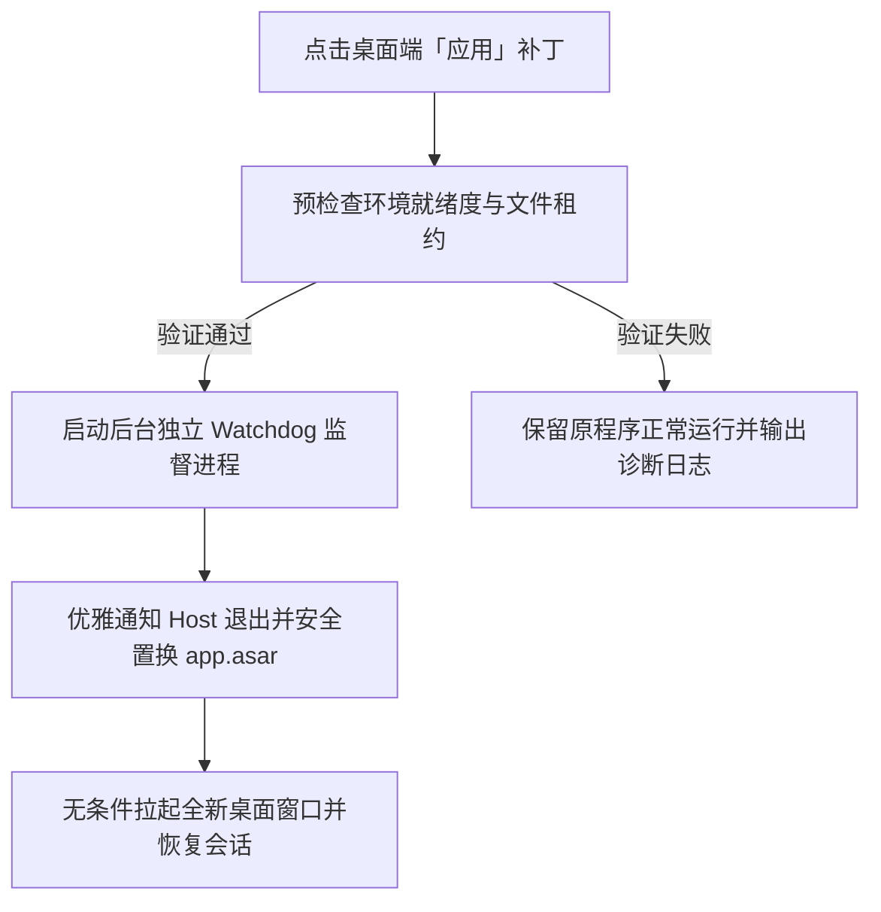

<p align="center">
  
</p>

<h1 align="center">⚔️ DeepSeek Harness Purge Plus (dsh-purge-plus)</h1>

<p align="center">
  <strong>专为官方 DeepSeek Harness 打造的本地补丁管理器 · 提示词自由配置引擎 · 规则与技能生态 · 内置红队演练台</strong>
</p>

<p align="center">
  <a href="https://github.com/ShadowCat2233/dsh-purge-plus/stargazers"></a>
  <a href="https://github.com/ShadowCat2233/dsh-purge-plus/releases"></a>
  <a href="https://www.deepseek.com/harness/"></a>
  <a href="https://nodejs.org/">= 18"></a>
  
  <a href="LICENSE"></a>
</p>

<p align="center">
  <strong>简体中文</strong> · <a href="README.md">English</a>
</p>

---

> [!NOTE]
> **本仓库定位与来源**：本项目是 [YuJunZhiXue/dsh-purge](https://github.com/YuJunZhiXue/dsh-purge)（原作者：**小杨**）的维护增强分支，由 [@ShadowCat2233](https://github.com/ShadowCat2233) 在 [@JeffKeeping](https://github.com/JeffKeeping) 分支基础上持续演进。
> 
> 本分支重点**保障官方 DeepSeek Harness 0.2.1-rc.2 及 0.2.x 版本的开箱可用性**，彻底修复官方桌面端「应用」补丁时的崩溃假死问题、修补变量解析异常，并完整保留本地红队演练控制台与 23 款随包安全技能。

---

## 目录

- [🌟 为什么选择 dsh-purge-plus？](#-为什么选择-dsh-purge-plus)
- [✨ 核心功能](#-核心功能)
- [🖼️ 界面预览](#️-界面预览)
- [🚀 快速开始与安装](#-快速开始与安装)
  - [1. Windows 官方桌面端一键安装（推荐）](#1-windows-官方桌面端一键安装推荐)
  - [2. 官方 Web 宿主一键安装](#2-官方-web-宿主一键安装)
  - [3. 本地源码克隆安装](#3-本地源码克隆安装)
  - [4. 让本地 AI 助手自动安装](#4-让本地-ai-助手自动安装)
  - [5. 手动安装方案（无全局 dsh 指令时）](#5-手动安装方案无全局-dsh-指令时)
- [📖 使用指南](#-使用指南)
  - [补丁应用与提示词注入](#补丁应用与提示词注入)
  - [自己的服务器（合法白名单）](#自己的服务器合法白名单)
  - [常用命令与快捷指令](#常用命令与快捷指令)
- [🔄 还原、卸载与更新](#-还原卸载与更新)
- [🛠️ 最近重大升级 (v1.4.x)](#️-最近重大升级-v14x)
- [🧪 自动化测试与工程验证](#-自动化测试与工程验证)
- [⚠️ 合规准则与免责声明](#️-合规准则与免责声明)
- [🤝 开源致谢与署名](#-开源致谢与署名)

---

## 🌟 为什么选择 dsh-purge-plus？

官方 DeepSeek Harness (DSH) 拥有出色的 Agent 执行能力，但在实际科研、评测与本地使用中常常受限：

1. **系统提示词锁死**：官方环境无法按模型定制 System Prompt，难以进行深度越狱评测与鲁棒性加固。
2. **桌面端 Apply 假死奔溃**：在 Windows 官方桌面端下，替换 `app.asar` 重启过程极易因为文件占用导致宿主被杀后无法重启（弹窗 `dsh desktop host stopped` 并永久瘫痪）。
3. **0.2.1 变量不兼容**：全新 0.2.1-rc.2 宿主在未注册 `{{cwd}}` 变量时会导致全局对话直接报错崩溃。
4. **缺乏工作区指令与红队环境**：缺少上下文规则（`AGENTS.md` / `CLAUDE.md`）识别，也没有离线受控的安全演练工具集。

**`dsh-purge-plus` 为此提供了一站式开箱即用的解决方案**，既能作为日常模型提示词定制与规则增强插件，又能作为本地合规红队评测控制台。

---

## ✨ 核心功能

### 🛡️ 1. 本地补丁与提示词注入引擎（破甲）
- **多模型提示词自由切换**：支持为不同模型定制独立 System Prompt，默认提示词高度面向国产主流模型（如「小码酱」）进行鲁棒性强化与约束穿透。
- **透明的补丁审计机制**：79 项精细化本地补丁，分组呈现；提供哈希级备份、一键应用 (Apply) 与无损还原 (Revert)。
- **安全交易与审批流水**：内置 `tool-gate` 显式审批模式、严格 JSON 边界过滤与 CAS 状态修订号保护，防止并发写入脏数据。

### ⚡ 2. 100% 可靠的 Windows 桌面重启看门狗 (v1.4.3)
- **独立监督看门狗进程**：先严格验证新环境就绪状态，再调度优雅关闭旧进程、置换 `app.asar`，并自动拉起桌面客户端，完整继承数据目录参数。
- **并发原子写与文件租约**：所有写盘与备份操作使用唯一临时文件并严格按目标路径串行提交，彻底告别 Windows 平台下的文件占用与锁死崩溃。

### 📜 3. 工作区规则策略中心 (Rules)
- **指令自动识别**：自动检索当前工作区与项目根目录下的 `AGENTS.md`、`CLAUDE.md` 等上下文指导规范。
- **多套规则切换**：可在设置面板中灵活管理、启用或删除规则集，精准控制模型上下文注入。

### 🧩 4. 用户技能生态对接 (Skills)
- **完全兼容官方规范**：无缝对接 DSH 用户 Skill 机制，支持通过 `.zip` 压缩包或本地文件夹一键导入自定义技能。

### ⚔️ 5. 内置网络安全红队演练台 (Red Team Console)
- **完整受控评测闭环**：提供演练项目 (Engagements)、资产库、会话隧道映射、智能体协作、攻防战果沉淀、攻击链图谱还原与量化评分报告生成。
- **随包附带 23 款实战技能**：预置涵盖环境探测、代码审计、网络连通分析等 23 款安全评估技能，完全本地离线运行，无需外网依赖。

---

## 🖼️ 界面预览

插件无缝集成至 DeepSeek Harness 原生 UI 体系，全面适配官方设计 Token 及浅色 / 深色主题，入口位于 **账号菜单 → 设置 → Purge**。

<div align="center">

| 设置页与补丁管理 (浅色) | 设置页与补丁管理 (深色) |
| :---: | :---: |
|  |  |

| 工作区规则管理 (Rules) | 网络安全红队演练台 (Console) |
| :---: | :---: |
|  |  |

</div>

<p align="center">
  
  <br>
  <em>图：Windows 官方桌面端真机实际运行效果（原生设置内嵌，无额外浮窗干扰）</em>
</p>

---

## 🚀 快速开始与安装

### 前置要求
- 已安装官方 DeepSeek Harness（**0.2.1-rc.2** 或兼容的 0.2.x 版本）。
- 系统环境具备 `Node.js >= 18`（Windows 环境推荐 `Node.js >= 22`，可保证后台脚本无闪窗静默运行）。
- 终端能够执行 `dsh` 指令。

> [!IMPORTANT]
> **Profile 选择指南**：
> - **官方 Windows 桌面端应用**：使用 `--profile desktop`
> - **官方 Web 宿主（终端运行 `dsh web`）**：使用 `--profile web`
> - 两端相互独立，若两端均使用，请分别安装并分别进入设置点击「应用」。

### 1. Windows 官方桌面端一键安装（推荐）

在 PowerShell 中直接运行：

```powershell
dsh plugin --profile desktop add https://github.com/ShadowCat2233/dsh-purge-plus/archive/refs/heads/main.tar.gz
```

### 2. 官方 Web 宿主一键安装

在终端运行：

```bash
dsh plugin --profile web add https://github.com/ShadowCat2233/dsh-purge-plus/archive/refs/heads/main.tar.gz
```

### 3. 本地源码克隆安装

如需本地调试或固定源码提交：

```bash
git clone https://github.com/ShadowCat2233/dsh-purge-plus.git
cd dsh-purge-plus

# 桌面端安装：
dsh plugin --profile desktop add .

# Web 端安装：
dsh plugin --profile web add .
```

---

<details>
<summary><strong>🤖 4. 让本地 AI 助手自动安装（点击展开复制 Prompt）</strong></summary>

将以下提示词完整复制并发送给你的本地编程助手：

```text
请帮我在本机安装 DeepSeek Harness 增强插件 dsh-purge-plus。
执行要求：
1. 检查环境变量中是否有 dsh 命令，若无则提示我配置 PATH。
2. 针对官方桌面端执行：
   dsh plugin --profile desktop add https://github.com/ShadowCat2233/dsh-purge-plus/archive/refs/heads/main.tar.gz
3. 针对官方 Web 端执行：
   dsh plugin --profile web add https://github.com/ShadowCat2233/dsh-purge-plus/archive/refs/heads/main.tar.gz
4. 命令执行完成后，提醒我完全退出并重新启动 DeepSeek Harness，并在「设置 -> Purge」中点击「应用」。
注意：不要修改其他系统文件，不要擅自代点应用或强制杀进程。
```

</details>

<details>
<summary><strong>⚙️ 5. 手动安装方案（无全局 dsh 指令时点击展开）</strong></summary>

若你的终端没有全局 `dsh` 命令，可手动定位 `$DSH_HOME` 配置：

1. **定位数据目录**：
   - 环境变量 `$env:DSH_HOME`，或 `%USERPROFILE%\.dsh`，或 `%APPDATA%\DeepSeek Harness\dsh-home`。
2. **下载并放置插件**：
   - 将本仓库解压到 `$DSH_HOME/plugins/dsh-purge`（目录名必须为 `dsh-purge`）。
3. **注册 Profile 依赖**：
   - 打开 `$DSH_HOME/profiles/desktop/package.json`（或 `web` 对应文件）。
   - 在 `dependencies` 中添加：`"dsh-purge": "file:../../plugins/dsh-purge"`。
   - 在 `dsh.profile.bundles` 数组最后追加 `"dsh-purge"`。
4. **安装依赖**：
   - 进入 `$DSH_HOME/profiles/desktop` 执行 `pnpm install`。
5. **启动应用**：
   - 重启宿主程序，进入「设置 → Purge」进行补丁应用。

</details>

---

## 📖 使用指南

### 补丁应用与提示词注入

1. **首次启用**：安装插件后，完全退出并重启 DeepSeek Harness。
2. **进入面板**：打开 **设置 → Purge**。
3. **点击「应用」(Apply)**：
   - 补丁引擎会自动备份原生文件，并将补丁打入本地运行时。
   - 在 Windows 桌面端，**看门狗守护机制将无感重启桌面客户端**，绝无崩溃假死风险。
4. **开始对话**：重启完成后，**新建一轮会话**，定制的提示词与破甲加固逻辑立即生效。

<div align="center">
  
</div>

### 自己的服务器（合法白名单）

为了严格遵循安全合规与防止误触外网，插件限制对非授权网段的操作。如果需要向自己的本地靶机或云服务器发起安全评测：

1. 在 **设置 → Purge** 面板中滚动至提示词下方找到 **「自己的服务器」**。
2. 每行填写一台你的测试目标（支持单个 IP，如 `192.168.1.100`，或完整主机名，如 `test-target.lab`）。
3. 点击 **「保存名单」**，系统将自动写入 `$DSH_HOME/net-scope-allow.txt`。

<div align="center">
  
</div>

### 常用命令与快捷指令

可在聊天输入框或终端中快捷调用插件能力：

| 交互渠道 | 命令格式 | 说明 |
| :--- | :--- | :--- |
| **CLI 命令行** | `dsh-purge --status` | 查看当前补丁状态与应用详情 |
| | `dsh-purge --apply` | 命令行执行补丁应用 |
| | `dsh-purge --revert` | 命令行执行补丁回滚还原 |
| | `dsh-purge --uninstall` | 彻底还原并卸载插件 |
| **聊天 Slash 命令** | `/purge status` | 在会话中查询补丁就绪度 |
| | `/purge apply` / `/purge revert` | 触发应用或回滚 |
| | `/rules list` / `/rules use <id>` | 查看或快速切换工作区规则集 |
| | `/skills list` / `/skills import` | 查询或导入本地 Skill 技能包 |

---

## 🔄 还原、卸载与更新

- **一键还原 (Revert)**：
  在设置面板点击「还原」，系统将通过哈希核验将所有打过补丁的文件 100% 恢复为官方初始状态，完成后重启即可。
- **彻底卸载 (Uninstall)**：
  点击面板中的「卸载」，引擎会**先执行无损还原**，随后清理插件注册信息、提示词覆盖与演练台授权，不污染官方程序。
- **在线更新 (Update)**：
  直接拉取本仓库最新归档重新执行 `add` 命令覆盖即可，本地保留的自定义提示词和测试数据不会丢失。

---

## 🛠️ 最近重大升级 (v1.4.x)



- **v1.4.3（当前版本）**：
  - **Windows 桌面端重启守护**：重构 `lib/windows-restart.js` 与独立 PowerShell 监督器，根除 `app.asar` 替换过程中的进程僵死问题。
  - **原子 I/O 串行提交**：引入唯一临时文件机制与目标锁，杜绝 Windows 平台上的文件读写碰撞。
- **v1.4.2**：
  - **输入框交互精简**：移除冗余的输入框「回退」UI 按钮与废弃路由，精简 3 条旧补丁（补丁总数收敛至 79 条），保持界面纯净轻量。
- **v1.4.1**：
  - **0.2.1 运行时兼容**：修复 DSH 0.2.1-rc.2 因缺少 `{{cwd}}` 变量注册导致的启动闪退问题。
- **v1.4.0**：
  - **安全基线加固**：引入 `lib/json-safe.js` 严格数据边界、`lib/tool-gate.js` 审批审计流水与 CAS 修订号校验。

---

## 🧪 自动化测试与工程验证

本项目具备严密的自动化测试套件，在 Windows 11 + 官方 DeepSeek Harness 0.2.1-rc.2 真实环境下完成全项验收：

```bash
# 运行 71 项门禁安全与数据边界测试
npm run test:gate

# 运行 32 路并发原子 I/O 与文件读写测试
npm run test:atomic

# 运行 Windows 桌面端重启守护崩溃防护测试
node test/windows-restart.mjs
```

测试结果：
- **71/71** Tool-gate、Host-lease、JSON-safe 及 Revision 测试全绿。
- **32/32** 高并发原子文件写盘无任何冲突、零临时文件残留。
- **57/57** 补丁文件恢复哈希与备份哈希 100% 一致。

---

## ⚠️ 合规准则与免责声明

本项目遵循开源软件精神及相关法律法规，请所有使用者严格遵守以下约定：

1. **授权与受控范围**：本项目仅限用于使用者**拥有完全所有权或已获得合法书面授权**的本机系统、本地自建靶场或离线攻防实验室。**严禁对任何公网目标、未授权机构系统进行任何形式的探测、扫描、渗透或攻击**。
2. **纯本地离线运行**：补丁及演练组件全部在本地 Harness 运行时内工作，绝不向任何第三方服务上传你的私有数据、API Key、提示词或敏感对话。
3. **禁止违法用途**：严禁将本项目用于传播恶意载荷、窃取机密数据、诱导违法违禁内容，使用者需独立对其一切使用行为及后果承担全部法律责任。
4. **禁止商业倒卖**：本项目为**非营利公益开源项目**，沿用上游非商业化许可条款，**严禁任何个人或团队进行商业转售、付费倒卖、打包卖课或黑灰产牟利**。

---

## 🤝 开源致谢与署名

`dsh-purge-plus` 的诞生与完善离不开开源社区多位开发者的先驱探索，特此郑重致谢：

- **[YuJunZhiXue/dsh-purge](https://github.com/YuJunZhiXue/dsh-purge)**：由 **小杨**（[@YuJunZhiXue](https://github.com/YuJunZhiXue)）发起的原始项目，奠定了核心补丁机制与提示词注入架构。保留原始 `Copyright (c) 2026 小杨` MIT 许可。
- **[JeffKeeping/dsh-purge-plus](https://github.com/JeffKeeping/dsh-purge-plus)**：本分支演进的直接上游来源。
- **[Jueze-2019/dsh-redteam-mode](https://github.com/Jueze-2019/dsh-redteam-mode)**：红队演练台面板、预设配置及 23 款随包技能的来源。
- **[Minglink/dsh-infinite-gen-5](https://github.com/Minglink/dsh-infinite-gen-5)**：提供了工具审批门禁 (Tool Gate)、数据修订号与严格 JSON 边界设计的架构灵感。

---

<p align="center">
  如果这个项目帮助解决了你的 DeepSeek Harness 使用痛点，欢迎点亮右上角的 <strong>Star ⭐</strong> 鼓励维护！
</p>
